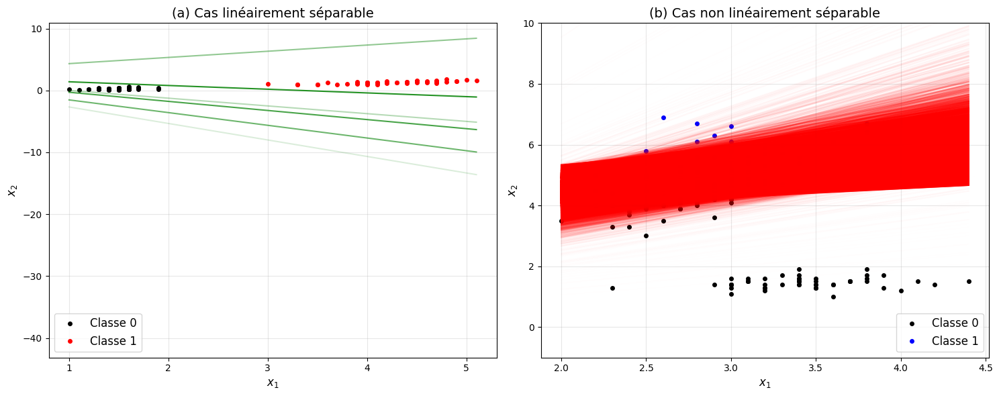
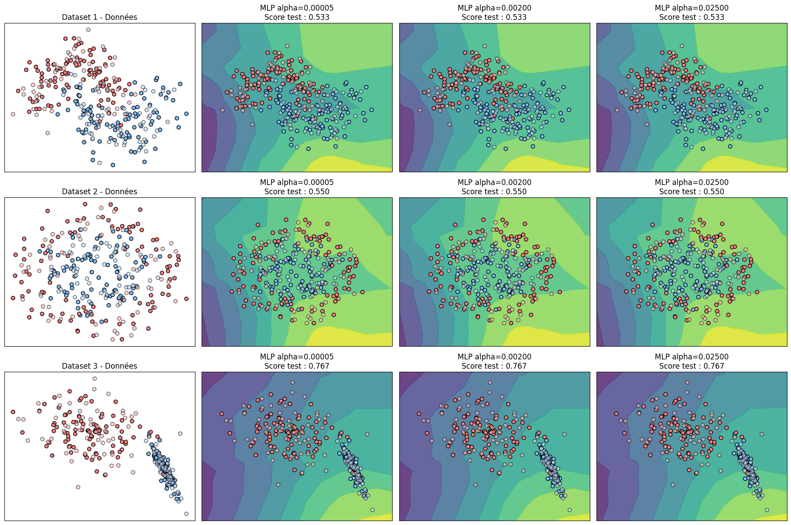
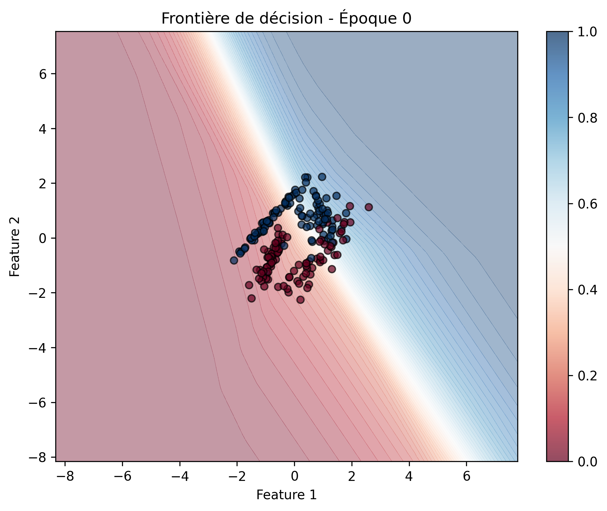
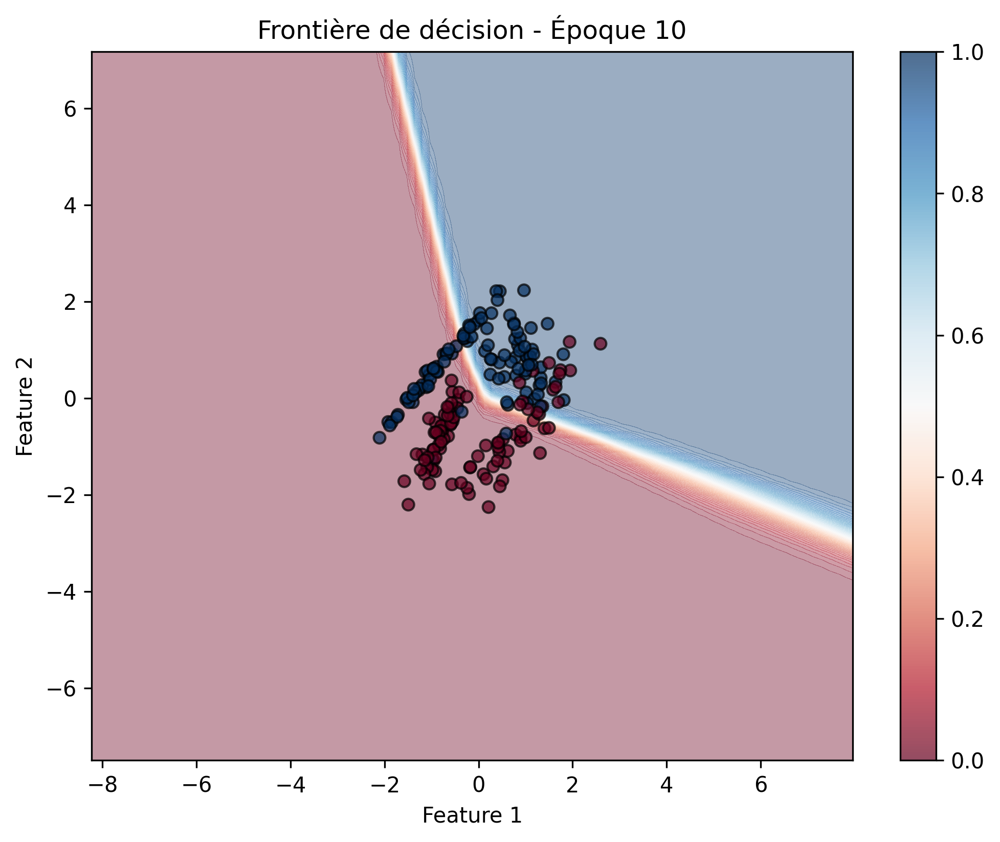
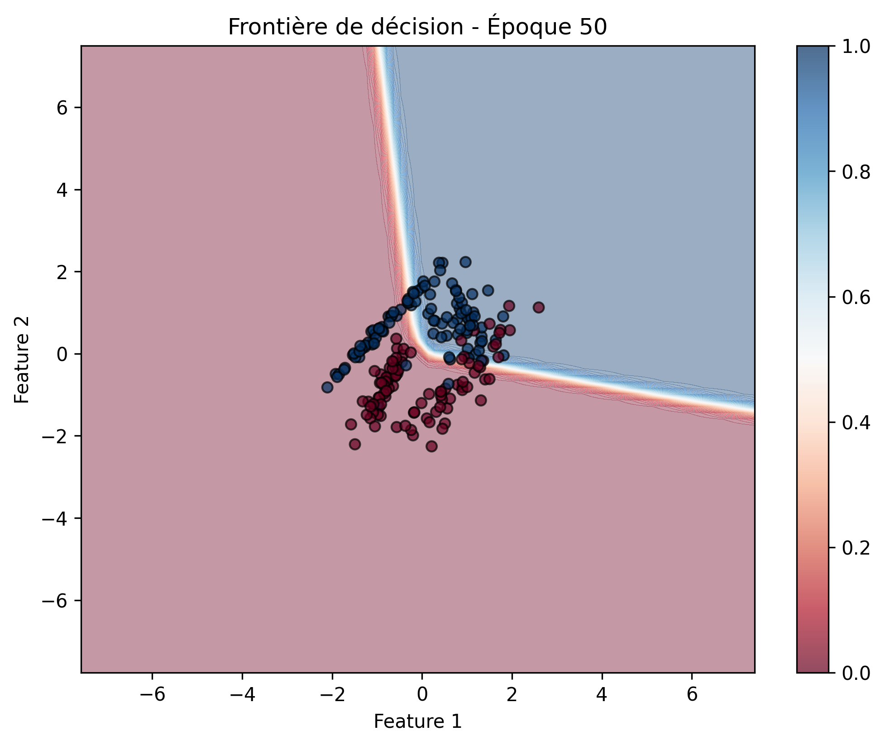
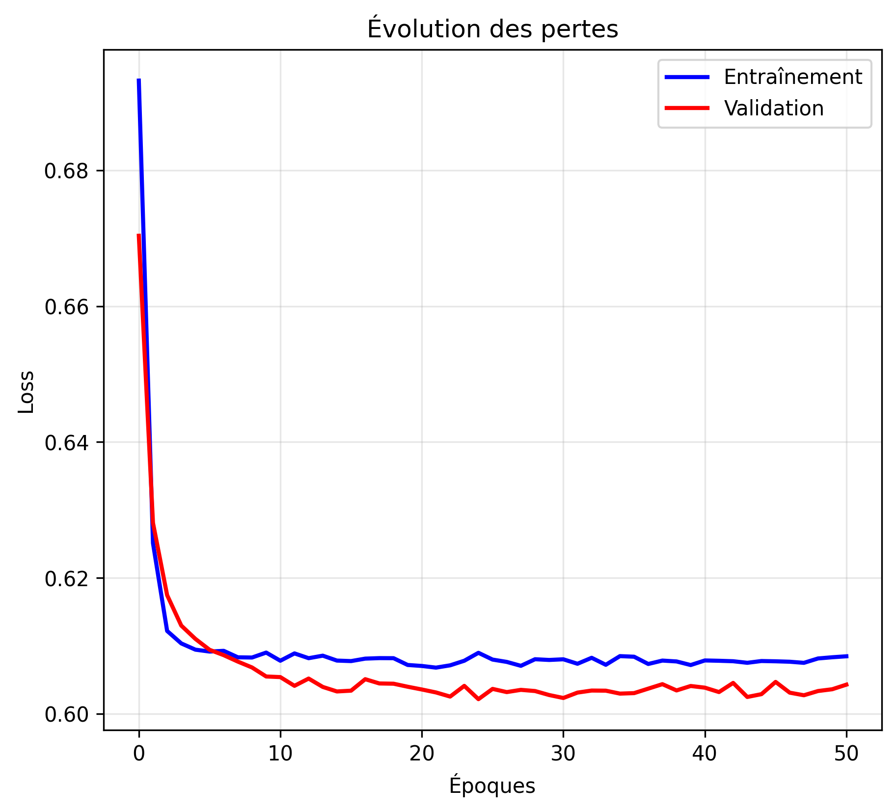
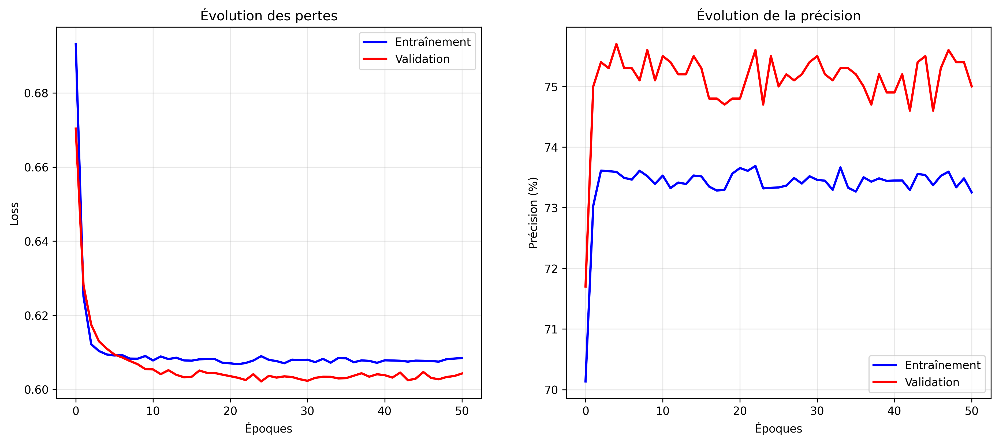
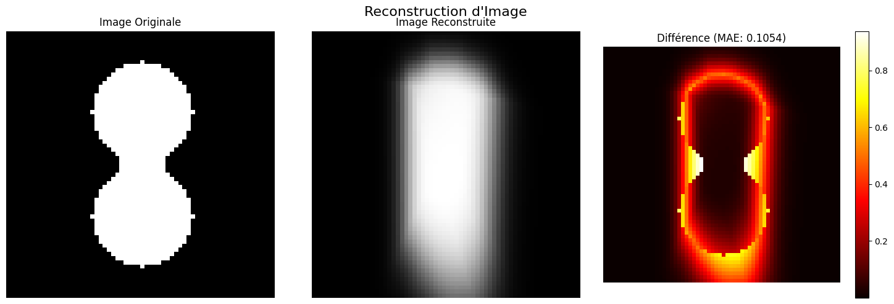
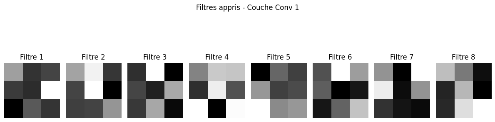
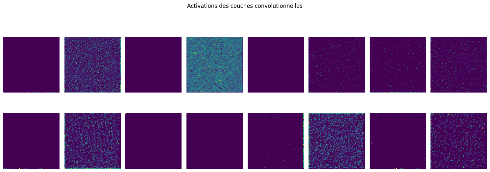

# Visualisation du fonctionnement des réseaux de neurones (TER)

Projet de TER — Université Toulouse III Paul Sabatier (2025).
Objectif : produire des outils Python qui illustrent de façon claire les transformations
qu'un réseau de neurones applique aux données pour aboutir à une classification ou à une
reconstruction : de l'unité de base (le perceptron) jusqu'aux réseaux convolutifs.

## Contenu

| Partie | Module | Ce qui est visualisé |
|---|---|---|
| Fondements | `src/ter_nn/activations.py` | Sigmoïde, ReLU, tanh |
| Perceptron | `src/ter_nn/perceptron.py` | Évolution de la frontière à chaque mise à jour des poids, cas séparable vs non séparable (NumPy, implémenté from scratch) |
| MLP (scikit-learn) | `src/ter_nn/mlp_sklearn.py` | Effet de la régularisation `alpha` sur la frontière de décision (3 jeux de données 2D) |
| MLP (PyTorch) | `src/ter_nn/data_generator.py`, `mlp_torch.py` | Frontière de décision aux époques 0 / 10 / 50, courbes de perte et de précision |
| Reconstruction d'image | `src/ter_nn/image_reconstruction.py` | MLP (x, y) → pixel, comparaison de 3 architectures (`simple`, `deep`, `wide`) |
| CNN | `src/ter_nn/cnn_visualization.py` | Filtres de la 1re couche convolutive et cartes d'activation de `conv1` / `conv2` |

Le notebook d'origine, rendu pour le TER, est conservé dans `notebooks/TER_original.ipynb`.

## Installation et exécution

```bash
pip install -r requirements.txt
mkdir -p results
python -m src.ter_nn.activations        # depuis la racine du dépôt
python -m src.ter_nn.perceptron
python -m src.ter_nn.mlp_sklearn
python -m src.ter_nn.mlp_torch
python -m src.ter_nn.image_reconstruction
python -m src.ter_nn.cnn_visualization
```

Les figures sont enregistrées dans `results/`. Les seeds sont fixées dans les scripts,
mais certaines étapes (permutation aléatoire du perceptron, génération des distributions)
restent stochastiques : les chiffres varient légèrement d'une exécution à l'autre.

## Résultats

### Perceptron
- Cas linéairement séparable (Iris, setosa vs versicolor) : convergence en quelques mises à jour
  (4 à 11 selon la permutation aléatoire des exemples).
- Cas non séparable : pas de convergence, arrêt à la limite de 10 000 mises à jour.



### MLP scikit-learn : effet de `alpha`
Trois valeurs (5e-5, 2e-3, 2.5e-2) sur make_moons, make_circles et make_classification ;
une plus forte régularisation lisse la frontière.



### MLP PyTorch sur distributions synthétiques
Entraînement 50 époques (Adam, lr = 1e-3). Précision de validation autour de **75 %**
(perte ≈ 0,60) à la fin de l'entraînement.

| Époque 0 | Époque 10 | Époque 50 |
|---|---|---|
|  |  |  |




### Reconstruction d'image par MLP
Image 64×64 (4 096 pixels), MLP 64-64, 100 époques : MAE d'entraînement ≈ 0,10 en fin
d'entraînement (MAE de validation ≈ 0,14, bruitée car la validation porte sur 10 % des pixels).



### CNN : filtres et activations



## Limites connues

- **MLP PyTorch** : le modèle se termine par une sigmoïde alors que la perte est
  `BCEWithLogitsLoss` (qui applique déjà une sigmoïde). Cela explique en partie le plafond à
  ~75 % de précision. Correction prévue : retirer la sigmoïde finale (ou utiliser `BCELoss`).
- Le CNN est entraîné sur **une seule image de bruit aléatoire** : il illustre la lecture des
  filtres et des activations, pas la performance d'un modèle.
- Les jeux de données sont synthétiques ou jouets (Iris, distributions 2D) : le projet est
  un outil pédagogique de visualisation, pas un benchmark.
- Pas de suite de tests automatisés.

## Partie 2 — Explicabilité (XAI) d'un ResNet18

Module `src/ter_nn/xai/` : outils pour **auditer les décisions d'un CNN / ResNet18**.

| Fichier | Rôle |
|---|---|
| `data.py` | Chiffres manuscrits (sklearn) 32×32 avec un **indice parasite volontaire** (carré blanc dont la position dépend de la classe, aligné avec la classe dans 90 % du train) |
| `gradcam.py` | Grad-CAM implémenté avec des hooks PyTorch + métrique « part d'attention sur l'indice parasite » |
| `filter_importance.py` | Importance des filtres d'une couche : ablation (chute de précision) et critère de Taylor \|activation × gradient\| |
| `dashboard.py` | Dashboard Matplotlib : pertes, précisions, évolution de la carte Grad-CAM au fil des époques (version statique + version interactive avec curseur) |
| `run_audit.py` | Pipeline complet : entraînement, audit de biais, importance des filtres, figures, `metrics.json` |

**Principe de l'audit.** Le réseau peut apprendre le « raccourci » (le carré) au lieu du chiffre.
On le teste sur trois conditions : carré aligné avec la classe, pas de carré, carré d'une autre
classe. Si la précision s'effondre dans la dernière condition et que Grad-CAM se concentre sur le
carré, le modèle a un biais de décision.

```bash
python -m src.ter_nn.xai.run_audit      # sorties dans results/xai/
```

### Résultats
> À compléter après exécution : copier les valeurs de `results/xai/metrics.json`
> (`acc_aligned`, `acc_none`, `acc_shuffled`, `patch_attention_*`, `filter_importance_spearman`)
> et ajouter les figures `gradcam_*.png`, `filter_importance.png`, `dashboard.png`.
> Ne reporter ici que les valeurs réellement obtenues.

**Statut.** Cette partie est une démonstration autonome (jeu de données jouet), distincte du
notebook de TER. Le ResNet18 est entraîné depuis zéro (pas de poids pré-entraînés).

## Pistes d'extension
- Appliquer Grad-CAM / importance des filtres à de vraies images (poids pré-entraînés, autre jeu de données).
- Corriger le défaut sigmoïde/BCE du MLP PyTorch (partie 1) et comparer.
- Ajouter des tests unitaires (forme des CAM, cohérence de l'ablation).
